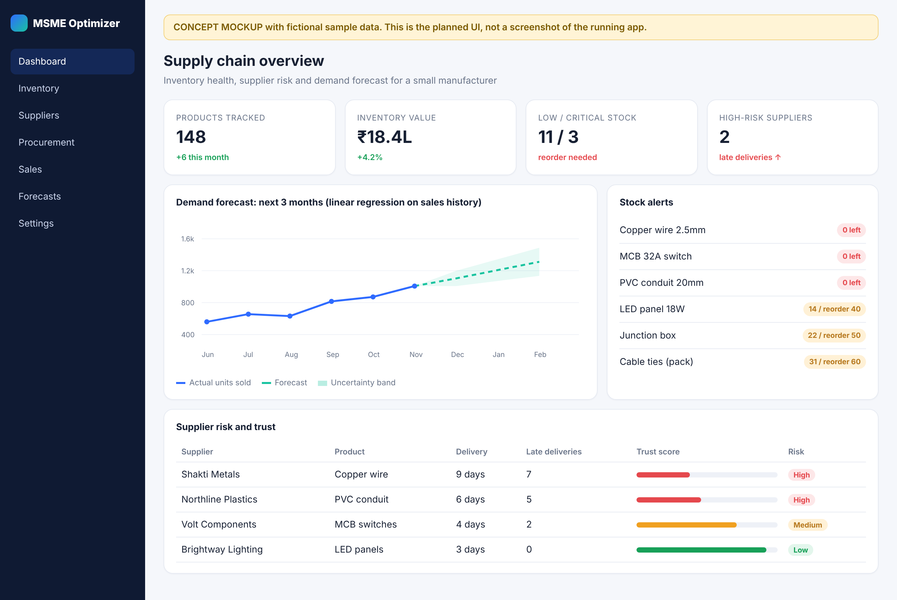

This starter includes a FastAPI app with SQLAlchemy async models and an Inventory router implemented.

## Planned dashboard (concept mockup)

> This image is a **design mockup with fictional sample data**, not a screenshot of the running app. The frontend (`mcp-dashboard/`) has not been built yet. The mockup shows what it will display from the existing API: inventory alerts, supplier risk and trust scores, and the linear-regression demand forecast. Its source is [`docs/mockups/dashboard-concept.html`](docs/mockups/dashboard-concept.html).



## Setup
1. Create a virtualenv and install requirements:

```bash
python -m venv .venv
source .venv/bin/activate
pip install -r requirements.txt
```

2. Copy `.env.example` to `.env` and update `DATABASE_URL`.

3. Run Postgres (locally or Docker). Example Docker command:

```bash
docker run --name mcp-postgres -e POSTGRES_PASSWORD=password -e POSTGRES_DB=mcp_db -p 5432:5432 -d postgres:15
```

4. Start the app:

```bash
uvicorn app.main:app --reload --host 0.0.0.0 --port 8000
```

5. Open Swagger UI at `http://localhost:8000/docs`
## Author

**Sparsh Khanal** · [GitHub](https://github.com/Sparsh-khanal75) · [LinkedIn](https://www.linkedin.com/in/Sparsh-khanal75)
